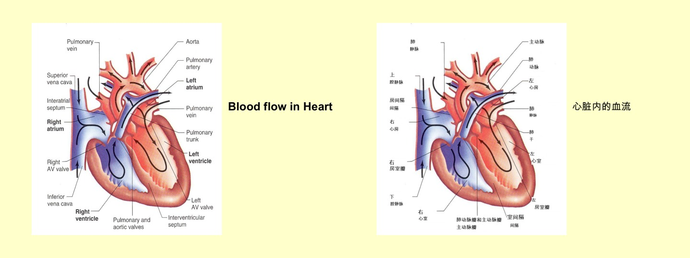
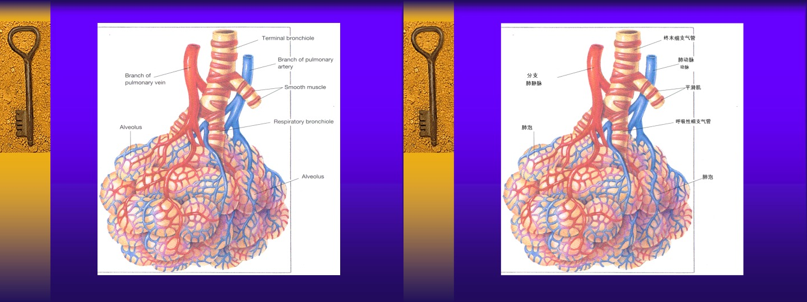
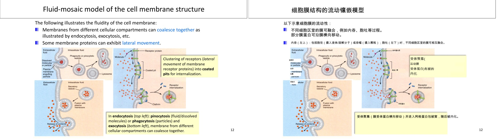
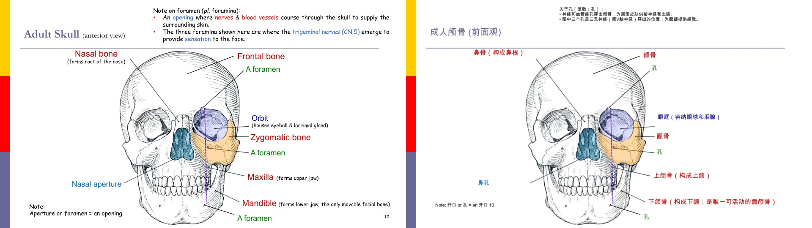

# Slide Page Translate

这个 skill 用于将课件逐页翻译成中文，并把原页与译页左右并排输出为 PDF。

## 文字版流程

```text
输入课件 PDF
    ↓
读取页数、尺寸和 PDF 原生文字
    ↓
逐页翻译原生文字并替换到译页，保留图形和原版布局
    ↓
Apple Vision 批量识别图片中的英文文字
    ↓
OCR 置信度 ≥ 0.5 → 通过识别门槛 → 大模型结合本页语义校正 → 翻译并覆盖原文字
OCR 置信度 < 0.5 → 放入待审查项 → 定点复看或局部放大识别 → 能确认的内容再翻译
    ↓
按整批总耗时处理
    ├─ ≤ 30 分钟：速度优先；疑难项不阻塞整批
    └─ > 30 分钟：可读英文内容翻译覆盖率必须达到至少 95%，定点补查低置信度项和图表漏项
    ↓
每页合成一张宽页：左侧原页 + 右侧中文译页
    ↓
自动检查页数、左右顺序、PDF 可读性，抽看少量代表页
    ↓
交付一个左右对照 PDF
```


## 实测记录

| 任务 | 页数 | 耗时 |
|---|---:|---:|
| 任务 A | 30 | 10 分 27 秒 |
| 任务 B | 36 | 10 分 19 秒 |
| 任务 C | 34 | 36 分 02 秒 |
| 任务 D | 84 | 26 分 18 秒 |

## 效果图








